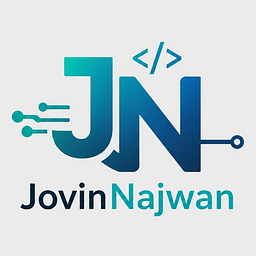

<div align="center">



# Jovin Najwan · Personal Website

**Full-Stack Web Developer building end-to-end web apps with TypeScript, Next.js, Express, PostgreSQL and Prisma.**

[](https://jovin-personal-website.vercel.app)


</div>

---

## ✨ About

This is my personal portfolio: a single-page site that introduces who I am, what I build, and how to reach me. It's designed to be fast, accessible, and pleasant to scroll through, with a dark navy/cyan theme and subtle motion throughout.

The UI follows the [UI/UX Pro Max](https://github.com/nextlevelbuilder/ui-ux-pro-max-skill) guidelines for portfolio sites: a motion-driven, minimal style with bento-grid cards and a storytelling section flow.

## 🧭 Sections

| # | Section | What's inside |
|---|---------|---------------|
| — | **Hero** | Intro, call-to-action buttons, and an animated `system.runtime.ts` code card |
| 01 | **About** | My story from scientific research to full-stack engineering, education timeline, and how I work |
| 02 | **Skills** | Front-end, back-end, and tooling capabilities plus a tech stack grid with brand logos |
| 03 | **Portfolio** | Featured projects with live demo and repository links in a browser-style preview |
| 04 | **Experience** | Animated timeline of my engineering journey |
| 05 | **Testimonials** | Words from my lecturer, classmates, and senior peers |
| 06 | **Contact** | A validated contact form and direct links (email, LinkedIn, GitHub) |

## 🚀 Highlights

- **Smooth, purposeful motion**: scroll reveals, staggered cards, and spring hover effects with Framer Motion. All animation respects the OS *reduce motion* setting.
- **Accessible by default**: skip-to-content link, visible focus rings, semantic landmarks, labelled form fields, and inline error messages linked with `aria-describedby`.
- **Validated contact form**: React Hook Form + Zod validation with loading and success/error feedback via toast notifications.
- **Responsive navigation**: blurred sticky navbar, active-section indicator, and an animated mobile menu (closes with <kbd>Esc</kbd>).
- **Optimized assets**: self-hosted fonts via `next/font` and responsive images via `next/image`.
- **Design tokens**: colors are defined once in `globals.css` as semantic Tailwind tokens (`accent`, `ink`, `canvas`, `card`, …), never as raw hex values in components.

## 🛠️ Tech Stack

| Category | Tools |
|----------|-------|
| Framework | [Next.js 16](https://nextjs.org) (App Router, Turbopack), [React 19](https://react.dev) |
| Language | [TypeScript](https://www.typescriptlang.org) |
| Styling | [Tailwind CSS 4](https://tailwindcss.com) |
| Animation | [Framer Motion](https://motion.dev) |
| Forms | [React Hook Form](https://react-hook-form.com) + [Zod](https://zod.dev) |
| HTTP & Feedback | [Axios](https://axios-http.com), [React Toastify](https://fkhadra.github.io/react-toastify) |
| Icons | [React Icons](https://react-icons.github.io/react-icons) (Feather + Simple Icons) |
| Backend (form storage) | [Backendless](https://backendless.com) |
| Deployment | [Vercel](https://vercel.com) |

## 📂 Project Structure

```
src/
├── app/
│   ├── globals.css      # Color palette, semantic tokens, shared utilities
│   ├── layout.tsx       # Fonts, metadata, skip link
│   └── page.tsx         # Assembles all sections
├── components/
│   ├── navbar.tsx
│   ├── hero.tsx
│   ├── about.tsx
│   ├── skills.tsx
│   ├── portofolio.tsx
│   ├── experience.tsx
│   ├── testimonials.tsx
│   ├── contact.tsx
│   ├── footer.tsx
│   └── motion.tsx       # Shared animation primitives (Reveal, Stagger, SectionHeading)
└── data/
    └── data.tsx         # All site content: nav, skills, tech stack, projects, testimonials
```

## 🏁 Getting Started

**Prerequisites:** Node.js 20+ and npm.

```bash
# 1. Clone the repository
git clone https://github.com/muzuijovin/Jovin-Personal-Website.git
cd Jovin-Personal-Website

# 2. Install dependencies
npm install

# 3. Start the development server
npm run dev
```

Then open [http://localhost:3000](http://localhost:3000).

### Available scripts

| Command | Description |
|---------|-------------|
| `npm run dev` | Start the development server |
| `npm run build` | Create a production build |
| `npm run start` | Serve the production build |
| `npm run lint` | Run ESLint |

## ✏️ Editing Content

Almost all content lives in [`src/data/data.tsx`](src/data/data.tsx), so updating the site rarely means touching a component.

**Add a new project:** append an object to `portfolioData`. The `PROJECT 01 / 0N` counter updates automatically.

```ts
{
  id: 2,
  status: "Mini Project",
  title: "My New Project",
  description: "What it does and why it matters.",
  tags: ["Next.js", "Tailwind CSS"],
  liveDemoUrl: "https://...",
  repositoryUrl: "https://github.com/...",
  imgSrc: "/my-new-project.png", // put the screenshot in /public
  siteUrlText: "my-new-project.vercel.app",
},
```

**Add a technology:** append to `techCloud` with any icon from [React Icons](https://react-icons.github.io/react-icons) and its brand color.

## 🎨 Color Palette

| Token | Hex | Used for |
|-------|-----|----------|
| `canvas` | `#041329` | Page background |
| `surface` | `#0D1C32` | Alternate section background |
| `card` | `#112036` | Cards |
| `accent` | `#4FDBC8` | Highlights, eyebrows |
| `accent-alt` | `#4CD7F6` | Primary buttons, numbers |
| `ink` | `#D6E3FF` | Headings and strong text |
| `ink-muted` | `#BCC9CD` | Body text |

Typography: **Manrope** (headings), **Geist** (body), **Space Mono** (labels and code).

## 📬 Contact

- **Email:** [jovin.najwan@gmail.com](mailto:jovin.najwan@gmail.com)
- **LinkedIn:** [linkedin.com/in/jovin-najwan-053870289](https://www.linkedin.com/in/jovin-najwan-053870289)
- **GitHub:** [github.com/muzuijovin](https://github.com/muzuijovin)

<div align="center">

---

Designed and built by **Jovin Najwan** · Depok, West Java, Indonesia 🇮🇩

If you like this project, consider giving it a ⭐

</div>
